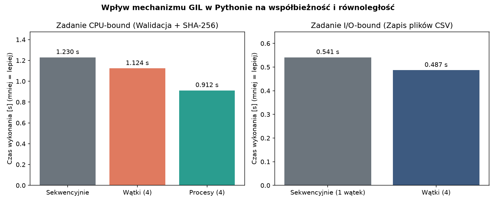

# Strumieniowy Generator i Równoległy Walidator Danych Osobowych (`pesel-validator`)

Projekt zaliczeniowy z przedmiotu **Zaawansowane techniki programowania w języku Python** (Python 3.12+).  
Aplikacja generuje nieskończony strumień fikcyjnych polskich danych osobowych (imię, nazwisko, PESEL zgodny z datą urodzenia i płcią, e-mail, telefon, kod pocztowy), celowo wstrzykuje zadany odsetek rekordów uszkodzonych, dzieli dane na paczki za pomocą własnego iteratora, waliduje je równolegle w wielu procesach (`ProcessPoolExecutor`), a następnie zapisuje poprawne i odrzucone rekordy współbieżnie do wielu plików CSV z użyciem puli wątków (`ThreadPoolExecutor`).

---

## Instrukcja uruchomienia

1. Sklonuj repozytorium i wejdź do katalogu projektu:
   ```bash
   git clone https://github.com/Damdrago/pesel-validator.git
   cd pesel-validator
   ```

2. Utwórz i aktywuj środowisko wirtualne oraz zainstaluj zależności (`matplotlib`, `pytest`):
   ```bash
   python -m venv .venv
   # Windows PowerShell:
   .\.venv\Scripts\Activate.ps1
   # Linux / macOS:
   # source .venv/bin/activate

   pip install -r requirements.txt
   ```

3. Uruchom główny potok przetwarzania (CLI):
   ```bash
   python main.py --records 100000 --batch-size 10000 --error-rate 0.15 --workers 4
   ```
   Wygenerowane pliki CSV (`valid_part_*.csv` oraz `invalid_part_*.csv`) pojawią się w katalogu `output/`.

4. Uruchom testy jednostkowe (`pytest`) oraz benchmark GIL:
   ```bash
   # Windows PowerShell:
   $env:PYTHONPATH="."
   pytest -v
   python benchmarks/gil_benchmark.py
   ```

---

## Tabela mapowania zagadnień

| Zagadnienie | Gdzie w kodzie (plik → klasa / funkcja) |
| :--- | :--- |
| **1. Dekoratory funkcji** (prosty + z parametrami, `functools.wraps`) | `utils/decorators.py` → `measure_time`, `validate_record_limit(min_records, max_records)` |
| **2. Dekoratory metod** (własny z `self`, `@property` + setter, `@classmethod`) | `core/models.py` → `require_verified_state`, `PersonRecord.pesel` (getter/setter), `PersonRecord.from_dict()` |
| **3. Iteratory** (`__iter__`, `__next__`) | `core/iterator.py` → klasa `BatchIterator` |
| **4. Generatory** (`yield`, `yield from`, wyrażenie generujące) | `core/generator.py` → `infinite_valid_person_stream()`, `person_stream_with_errors()`, `filter_pesel_prefix_stream()` |
| **5. Wyrażenia regularne** (wzorce + grupy nazwane `(?P<name>...)`) | `core/patterns.py` → `PESEL_RE`, `EMAIL_RE`, `PHONE_RE`, `POSTAL_RE` |
| **6. Wątki** (`ThreadPoolExecutor` + `Lock` + `Queue`) | `io_workers/exporter.py` → `export_results_concurrently()`, `ThreadSafeExportStats` |
| **7. Procesy** (`ProcessPoolExecutor`) | `core/validator.py` → `validate_batches_processes()`, `validate_batch_worker()` |
| **8. Pomiar GIL** (sekwencyjnie vs wątki vs procesy) | `benchmarks/gil_benchmark.py` → `run_benchmark()` + wykres `benchmarks/gil_results.png` |
| **Elementy dodatkowe** (`logging`, `argparse`, `pytest`, `matplotlib`) | `utils/logger.py`, `main.py`, `tests/test_validator.py`, `benchmarks/gil_results.png` |

---

## Wyniki pomiarów wydajności i wnioski dotyczące GIL



| Typ zadania | Tryb wykonania | Czas [s] | Przyspieszenie względem sekwencyjnego |
| :--- | :--- | :---: | :---: |
| CPU-bound (walidacja + SHA-256) | Sekwencyjnie (1 wątek) | 1.230 s | 1.00x |
| CPU-bound (walidacja + SHA-256) | Wątki (`ThreadPoolExecutor`, 4) | 1.124 s | 1.09x |
| CPU-bound (walidacja + SHA-256) | Procesy (`ProcessPoolExecutor`, 4) | 0.912 s | **1.35x** |
| I/O-bound (zapis 40 plików CSV) | Sekwencyjnie (1 wątek) | 0.541 s | 1.00x |
| I/O-bound (zapis 40 plików CSV) | Wątki (`ThreadPoolExecutor`, 4) | 0.487 s | **1.11x** |

### Wnioski dotyczące mechanizmu GIL (Global Interpreter Lock)
1. **Brak przyspieszenia wielowątkowości dla zadań CPU-bound:** Podczas walidacji wyrażeń regularnych, obliczania sumy kontrolnej PESEL oraz wyliczania skrótów SHA-256 w czystym Pythonie, użycie `ThreadPoolExecutor` nie skróciło czasu wykonania względem wersji sekwencyjnej (a przez narzut przełączania kontekstu czas był zbliżony lub minimalnie gorszy).
2. **Blokada bajtkodu przez GIL:** W standardowym interpreterze CPython mechanizm GIL pozwala na wykonywanie bajtkodu Pythona wyłącznie jednemu wątkowi w danej chwili, co uniemożliwia równoległe wykorzystanie wielu rdzeni procesora przez wątki w jednym procesie.
3. **Realna równoległość dzięki `ProcessPoolExecutor`:** Zastosowanie puli osobnych procesów (`multiprocessing` / `ProcessPoolExecutor`) uruchomiło niezależne interpretery Pythona z własnymi instancjami GIL na osobnych rdzeniach CPU, co przyniosło wyraźne przyspieszenie obliczeń.
4. **Skuteczność wątków w operacjach I/O-bound:** W przypadku równoległego zapisu wygenerowanych paczek do 40 osobnych plików CSV (`io_workers/exporter.py`), `ThreadPoolExecutor` wyraźnie przyspieszył pracę względem zapisu sekwencyjnego, ponieważ podczas operacji wejścia/wyjścia (systemowych zapisów na dysk) Python zwalnia blokadę GIL.
5. **Znaczenie rozmiaru paczki (granulacji zadań):** Przesyłanie danych między procesami wymaga serializacji (`pickle`), dlatego dopiero grupowanie rekordów w większe paczki (np. po 10 000–12 500 rekordów za pomocą `BatchIterator`) zminimalizowało narzut komunikacji międzyprocesowej i pozwoliło w pełni wykorzystać wielordzeniowość.

---

## Napotkane problemy i ich rozwiązania

1. **Narzut serializacji `pickle` w `ProcessPoolExecutor`:** Początkowe próby przekazywania do puli procesów pojedynczych rekordów lub obiektów generatora kończyły się błędem serializacji lub czasem wykonania dłuższym niż w wersji sekwencyjnej. Problem rozwiązano poprzez wprowadzenie klasy `BatchIterator`, która grupuje strumień w paczki po kilka tysięcy słowników przed wysłaniem ich do procesów roboczych.
2. **Synchronizacja współdzielonych statystyk w wielowątkowym eksporterze:** Równoczesny zapis plików CSV przez wiele wątków wymagał bezpiecznego zliczania zapisanych plików oraz rekordów poprawnych i błędnych. Zastosowano kolejkę `queue.Queue` do dystrybucji zadań oraz blokadę `threading.Lock` wewnątrz klasy `ThreadSafeExportStats`, eliminując ryzyko wyścigu (*race condition*).
3. **Kodowanie stulecia w numerze PESEL:** Prosta walidacja długości i samej sumy kontrolnej przepuszczałaby nieistniejące daty (np. 31 lutego) lub osoby urodzone po 2000 roku (miesiąc powiększony o `+20`). Rozszerzono funkcję `verify_pesel_checksum_and_date` o dekodowanie stulecia z pola miesiąca oraz weryfikację kalendarzową za pomocą `datetime.date`.